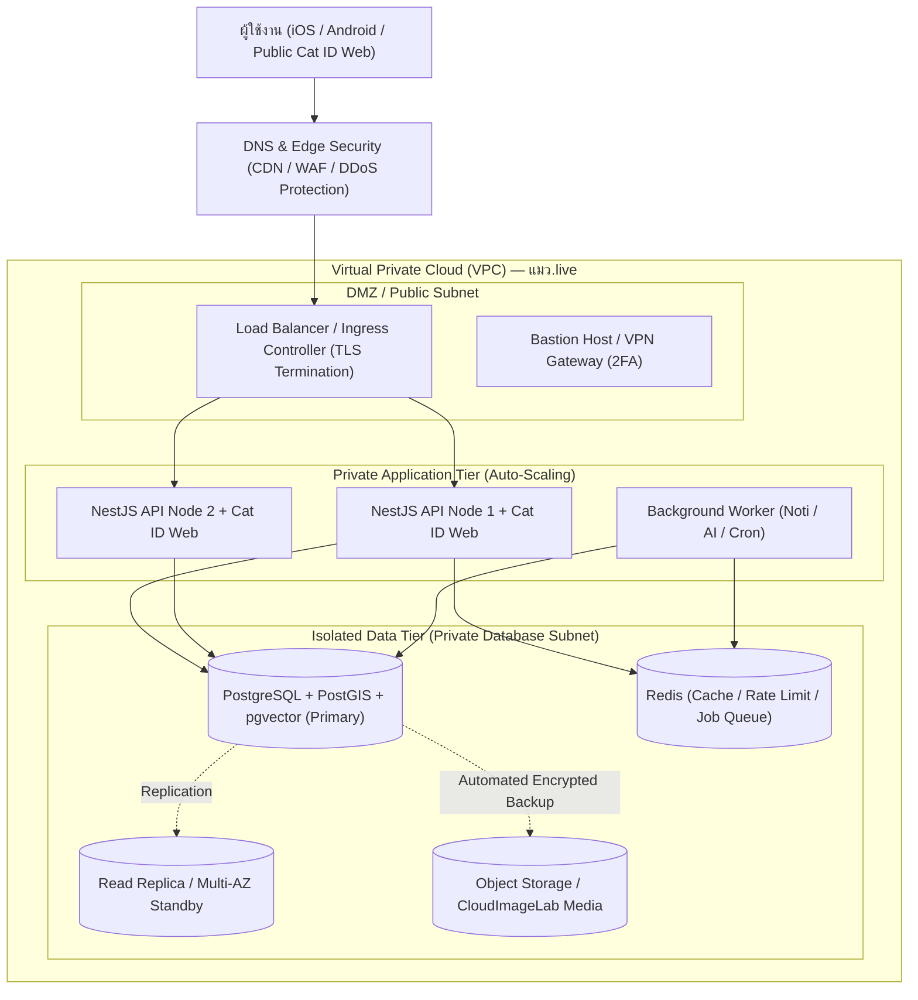

# เอกสารข้อกำหนดสถาปัตยกรรมโครงสร้างพื้นฐานและระบบปฏิบัติการ (DevOps & Infrastructure Specification) — แมว.live

- **ชื่อระบบ / โปรเจกต์:** แมว.live
- **สภาพแวดล้อมที่ครอบคลุม:** Development | Staging / UAT | Production | Disaster Recovery (DR)
- **รูปแบบสถาปัตยกรรมคลาวด์ / โฮสติ้ง:** Virtual Private Cloud (VPC) หลายระดับชั้น / Containerized Architecture

---

## 1. [มิติที่ 1 & 8] แผนผังสถาปัตยกรรมเครือข่ายและการจัดวางระบบ (Network & Deployment Topology)
> แบ่งโซนเครือข่าย Public/Private Subnet แยกขาดระหว่างEdge, Application Tier และ Data Tier เพื่อป้องกันการเข้าถึงฐานข้อมูลและข้อมูลอ่อนไหว (PDPA-04) จากภายนอก

### 1.1 รายละเอียดทรัพยากรและสภาพแวดล้อม (Compute & Environment Specifications)
| สภาพแวดล้อม | รูปแบบการรันระบบ (Compute Runtime) | ขนาดทรัพยากร (vCPU / RAM / Disk) | กลยุทธ์การขยายระบบ (Scaling Strategy) |
| :--- | :--- | :--- | :--- |
| **Production** | Managed Container Cluster / Kubernetes | 4 vCPU, 16 GB RAM, 100 GB NVMe x 2 Nodes (API + Worker แยกกัน) | Auto-scaling แนวนอน (Min 2, Max 8) เมื่อ CPU > 70% เพื่อรองรับ 5,000 Concurrent Users |
| **Staging / UAT** | Docker Compose / Managed Container | 2 vCPU, 4 GB RAM, 50 GB SSD | Fixed 1 Instance สำหรับทดสอบเชื่อม Mobile App (iOS/Android) ก่อนปล่อยจริง |

---

## 2. [มิติที่ 8] กระบวนการ CI/CD และการจัดการโครงสร้างพื้นฐานด้วยโค้ด (CI/CD Pipeline & IaC)
- **การจัดการโครงสร้างพื้นฐานด้วยโค้ด (Infrastructure as Code - IaC):**
  - กำหนดค่าสภาพแวดล้อม, VPC, Database และ Container ผ่าน Docker Compose / Terraform เพื่อสร้างสภาพแวดล้อมใหม่ซ้ำได้แม่นยำ
- **กระบวนการ Continuous Integration (CI):**
  - **Mobile Client (`app/`):** รัน `flutter analyze` (0 issues) และ `flutter test` อัตโนมัติทุกครั้งที่มีการเปิด Pull Request / Merge เข้า `dev` และ `master`
  - **Backend API:** รัน ESLint, Unit/Integration Test, Static Security Analysis (SAST) และ Container Vulnerability Scan
- **กระบวนการ Continuous Deployment (CD) & กลยุทธ์การปล่อยเวอร์ชัน:**
  - รูปแบบการ Deploy ฝั่ง API: Rolling Update / Blue-Green Deployment แบบ Zero-Downtime พร้อม Automated Rollback ภายใน `<= 5 นาที` หาก Health Probe ล้มเหลว
  - ฝั่ง Mobile App: ใช้ Fastlane / Store Track สำหรับ TestFlight (iOS) และ Google Play Internal Testing พร้อมระบบ Feature Flag (`OPS-04`) ปิด-เปิดฟีเจอร์และบังคับอัปเดตเวอร์ชันขั้นต่ำจากหลังบ้าน
- **การจัดการ Schema Migration ใน Pipeline:**
  - รัน Database Migration (Backward-compatible) ก่อนสลับ Traffic ไปยัง API เวอร์ชันใหม่ เพื่อไม่ให้ล็อกตารางสำคัญใน Production

---

## 3. [มิติที่ 6] ความมั่นคงปลอดภัยระดับโครงสร้างพื้นฐานและการควบคุมสิทธิ์ (Security & Secrets Management)
- **การรักษาความปลอดภัยขอบเขตเครือข่าย (Network Perimeter & Firewall):**
  - อนุญาตการเข้าถึงจากอินเทอร์เน็ตเฉพาะพอร์ต `443` (HTTPS / TLS 1.2+) ผ่าน Edge WAF และ Rate Limiter เท่านั้น; ฐานข้อมูล PostgreSQL และ Redis อยู่ใน Private Subnet ห้ามเปิดพอร์ตสาธารณะเด็ดขาด
- **การจัดการข้อมูลความลับและคีย์ (Secrets & Key Management):**
  - จัดเก็บ Database Credentials, JWT Signing Keys, Encryption Keys (AES-256 สำหรับข้อมูลอ่อนไหว `PDPA-04`), LINE/Apple/Google OAuth Secrets, AI API Keys และ Payment Secrets ไว้ใน Secrets Manager / Vault โดยไม่ฝังในโค้ดหรือ Git Repository
- **การควบคุมสิทธิ์การเข้าถึงเซิร์ฟเวอร์ (IAM & Access Control):**
  - ปฏิบัติตามหลัก Least Privilege; การเข้าถึงระบบ Production และ Back-office (`OPS-01`) บังคับใช้ 2FA และ VPN / Bastion Host พร้อมบันทึก Audit Log ทุกคำสั่ง

---

## 4. [มิติที่ 3, 5 & 7] ความเสถียร การรองรับโหลดสูง และแผนกู้คืนระบบ (High Availability, Scalability & Disaster Recovery)
- **เป้าหมายระดับการให้บริการ (SLA, RTO & RPO Targets):**
  - **เป้าหมายความพร้อมใช้งาน (SLA):** `99.5%` สำหรับ MVP และขยายสู่ `99.9%` Uptime ในระยะเต็มรูปแบบ (`NFR-02`)
  - **ระยะเวลาย้อนหลังของข้อมูลที่ยอมรับการสูญหายได้ (RPO):** สำรองข้อมูลรายวัน (RPO 24 ชม. ในระยะเริ่มต้น) และ Point-in-Time Recovery (RPO `<= 15 นาที` ใน Production เต็มรูปแบบ)
  - **เวลาที่ใช้ในการกู้คืนระบบกลับสู่สภาวะปกติ (RTO):** ภายใน `<= 4 ชั่วโมง` (และลดเหลือ `<= 60 นาที` เมื่อเปิด Multi-AZ Standby)
- **ความทนทานของฐานข้อมูลและคิวงาน (Data & Messaging Resilience):**
  - ใช้ Connection Pooling (PgBouncer) และ Read Replica สำหรับคิวรีอ่านหนัก (Feed / Search / Nearby) พร้อมแยก Redis Queue เพื่อไม่ให้คิวแจ้งเตือนหรือ AI ดึงทรัพยากร API หลัก
- **กลยุทธ์การสำรองข้อมูลและการซ้อมกู้คืน (Backup & Disaster Recovery Procedures):**
  - สำรองฐานข้อมูลและ Object Storage อัตโนมัติทุกวันแบบเข้ารหัสไว้คนละโซน (Off-site) พร้อมซ้อมกู้คืน (DR Drill) ตามรอบเวลา

---

## 5. [มิติที่ 7 & 8] ระบบติดตามผล ล็อกกลาง และการรับมือเหตุฉุกเฉิน (Observability, Telemetry & Incident Runbook)
- **การตรวจสอบสถานะระบบ (Health Probes):**
  - Endpoint `/healthz` (Liveness) และ `/readyz` (Readiness ตรวจการเชื่อมต่อ PostgreSQL และ Redis) ให้ Orchestrator ตรวจสอบอัตโนมัติ
- **ระบบติดตามตัวชี้วัดประสิทธิภาพ (Metrics & Monitoring):**
  - ติดตามค่า Latency (หน้าแรก `< 2 วิ`, Cat AI เริ่มสตรีม `< 3 วิ` ตาม `NFR-01`), ปริมาณ Traffic, อัตรา Error 5xx, อัตรา Crash-free (`>= 99.5%` ตาม `NFR-05`) และโควตาค่าใช้จ่าย AI
- **ระบบรวบรวมล็อกส่วนกลาง (Centralized Logging):**
  - Structured JSON Logs โดย **ห้ามเก็บข้อมูลส่วนบุคคล (PII)** ใน Log (`NFR-05`) และเก็บ Audit Logs แยกต่างหากตามระยะเวลากฎหมาย PDPA
- **การแจ้งเตือนเหตุขัดข้องและขั้นตอนปฏิบัติการ (Alerting & On-Call Runbook):**
  - แจ้งเตือน Tech Lead อัตโนมัติทันทีเมื่อ Error Rate พุ่งสูง, AI Provider ล่ม หรือคิวงานค้าง พร้อม Incident Runbook สำหรับสลับ AI Provider / ปิด Feature Flag (`OPS-04`) เมื่อเกิดเหตุฉุกเฉิน
