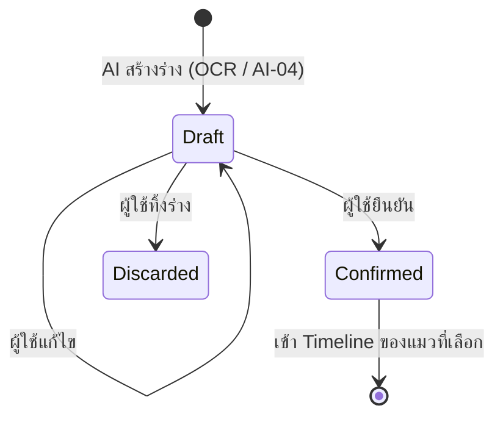
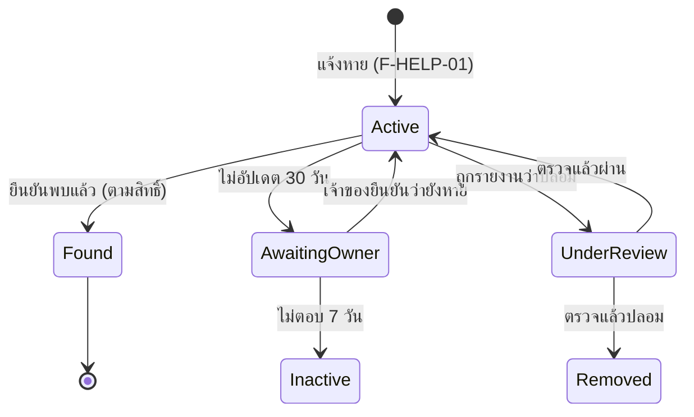
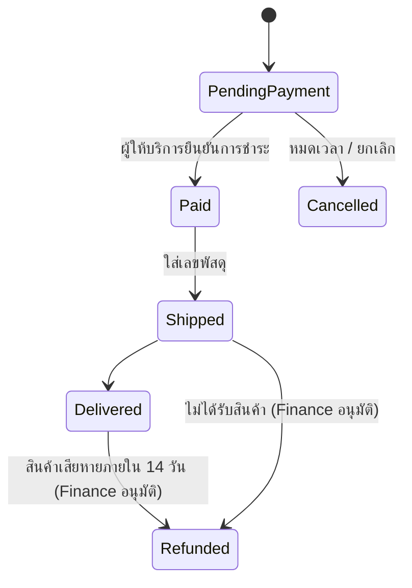
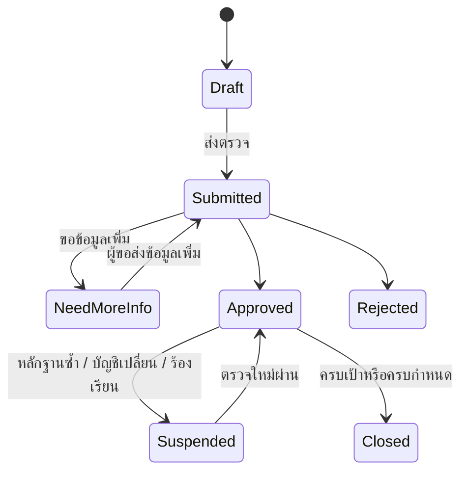

# Feature Specification & RTM Matrix (Part 2/2: Tag, Donation, Ops, PDPA, Workflows) — แมว.live

> ที่มา: แมว.live · เอกสารเก็บความต้องการระบบ v0.6 (16 พ.ย. 2569) — ต่อจาก Part 1/2

### 1.4 ร้านค้า Tag และการบริจาค (MVP)
| รหัสฟีเจอร์ | ชื่อฟีเจอร์ (Feature Name) | ขอบเขตการทำงาน (Description) | เกณฑ์การตรวจรับมาตรฐาน (Standard Acceptance Checklist) | ความสำคัญ |
| :---: | :--- | :--- | :--- | :---: |
| **TAG-01** | หน้าสินค้า Tag | หน้าสินค้า Tag และปลอกคอ พร้อมรูป 3D หมุนดูได้ ราคา สี และรายละเอียด | 1. ราคาตรงกับหลังบ้าน (OPS-03) 2. หมุนดูรูป 3D ได้ | ปานกลาง |
| **TAG-02** | ช่องทางสั่งซื้อ Tag | iOS: ปุ่ม "สั่งซื้อบนเว็บ" เปิดเบราว์เซอร์ภายนอก / Android และเว็บ: จ่ายผ่าน QR PromptPay หรือบัตร `[รอสรุป]` | 1. iOS ไม่มีหน้าจ่ายเงินในแอป 2. Android และเว็บชำระสำเร็จทั้ง 2 วิธี | ปานกลาง |
| **TAG-03** | ผูก Tag กับแมว | สแกน QR บน Tag หนึ่ง Tag ต่อแมวหนึ่งตัว ย้ายได้เมื่อ Tag หาย | 1. สแกน Tag แล้วเปิด Cat ID ของแมวที่ผูก 2. ผูก Tag เดียวกับแมว 2 ตัวไม่ได้ | ปานกลาง |
| **TAG-04** | สถานะออเดอร์ | รอชำระ → ชำระแล้ว → จัดส่ง (เลขพัสดุ) → ส่งถึง / ยกเลิก | 1. ผู้ซื้อได้แจ้งเตือนทุกสถานะ 2. แสดงเลขพัสดุเมื่อจัดส่ง | ปานกลาง |
| **TAG-05** | คืนเงินและใบเสร็จ | คืนเงินเมื่อสินค้าเสียหายหรือไม่ได้รับภายใน 14 วัน `[รอสรุป]` ออกใบเสร็จอิเล็กทรอนิกส์ | 1. หลังบ้านอนุมัติคืนเงินและบันทึกผู้อนุมัติ 2. ผู้ซื้อได้ใบเสร็จ | ปานกลาง |
| **DON-00** | แสดงเคสระดมทุน | แสดงเคสใน Help โดยไม่มีปุ่มรับเงินใน MVP | 1. เห็นเฉพาะเคสที่ผ่าน DON-04 2. ไม่มีปุ่มบริจาคและข้อมูลบัญชี | ปานกลาง |
| **DON-04** | อนุมัติและเผยแพร่เคส | ร่าง → ส่งตรวจ → ขอข้อมูลเพิ่ม / อนุมัติ / ปฏิเสธ หน้าเคสแสดงวัตถุประสงค์ เป้าหมาย ระยะเวลา สถานะ | 1. สถานะเปลี่ยนตามลำดับที่กำหนด 2. หลักฐานที่แสดงปกปิดข้อมูลส่วนตัวแล้ว | ปานกลาง |
| **DON-06** | ร้องเรียนและระงับเคส | ช่องรายงานเคส พักหน้าเคสเมื่อพบหลักฐานซ้ำ บัญชีเปลี่ยน หรือมีข้อร้องเรียน | 1. เก็บเหตุผลและผู้ตรวจทุกครั้ง 2. เคสที่ถูกพักไม่แสดงต่อผู้ใช้ | ปานกลาง |

### 1.5 การแจ้งเตือน หลังบ้าน PDPA และ Store
| รหัสฟีเจอร์ | ชื่อฟีเจอร์ (Feature Name) | ขอบเขตการทำงาน (Description) | เกณฑ์การตรวจรับมาตรฐาน (Standard Acceptance Checklist) | ความสำคัญ |
| :---: | :--- | :--- | :--- | :---: |
| **NOTI-01** | ประเภทการแจ้งเตือน | เตือนการดูแล, มีคนพบแมว, แมวหายใกล้ตัว, คำเชิญผู้ดูแล, DM, ปฏิสัมพันธ์บนโพสต์, ออเดอร์, ประกาศจากทีม | 1. เปิดปิดแยกตามประเภทได้ 2. "มีคนพบแมว" ปิดไม่ได้ | สูง |
| **NOTI-02** | ช่วงห้ามรบกวน | 22:00–07:00 ตั้งค่าได้ ยกเว้นเตือนยาและมีคนพบแมว | 1. ไม่มีแจ้งเตือนอื่นในช่วงที่ตั้ง 2. เตือนยาและพบแมวยังส่งถึง | ปานกลาง |
| **NOTI-03** | กล่องแจ้งเตือนและ deep link | กล่องแจ้งเตือนในแอป แตะแล้วเปิดหน้าที่เกี่ยวข้อง | 1. แตะ push แล้วไปหน้าถูกต้องทั้งตอนแอปปิดและเปิดอยู่ | สูง |
| **OPS-01** | ระบบหลังบ้านและบทบาท | เว็บหลังบ้าน บทบาท Admin / Moderator / Ops / Finance บันทึก audit log ทุกการกระทำ | 1. แต่ละบทบาทเห็นเฉพาะเมนูของตน 2. เข้าสู่ระบบด้วย 2FA 3. ทุกการกระทำมี audit log | สูง |
| **OPS-02** | คิวตรวจเนื้อหา | รายงานโพสต์ คอมเมนต์ DM ประกาศ และที่ AI-13 ตรวจพบ ซ่อน / ลบ / เตือน / ระงับบัญชี | 1. รายงานได้รับการตรวจภายใน 24 ชั่วโมง `[รอสรุป]` 2. ผู้รายงานได้แจ้งผล | สูง |
| **OPS-03** | จัดการสินค้า ออเดอร์ และข้อมูลอ้างอิง | สินค้า ราคา สต็อก ออเดอร์ เลขพัสดุ คืนเงิน ตรวจเคสบริจาค ข้อมูลคลินิกและเบอร์ฉุกเฉิน | 1. แก้ในหลังบ้านแล้วแอปเห็นภายใน 5 นาที | สูง |
| **OPS-04** | Feature flag และบังคับอัปเดต | flag แยกตามแพลตฟอร์มและเวอร์ชันแอป เปิดปิดได้โดยไม่ต้องอัปเดตแอป บังคับอัปเดตเมื่อเวอร์ชันต่ำกว่ากำหนด | 1. ปิด flag แล้วฟีเจอร์หายภายในการเปิดแอปครั้งถัดไป 2. เวอร์ชันต่ำกว่ากำหนดถูกบังคับอัปเดต | สูง |
| **PDPA-01** | ความยินยอม | นโยบายความเป็นส่วนตัว ข้อกำหนดการใช้งาน ขอความยินยอมแยกเรื่อง: ตำแหน่ง การตลาด ใช้ข้อมูลฝึก AI | 1. ถอนความยินยอมได้จาก Settings 2. เก็บประวัติความยินยอมพร้อมเวอร์ชัน | สูง |
| **PDPA-02** | ขอสำเนาและลบข้อมูล | ขอสำเนาข้อมูลของตนเอง (JSON + PDF) และลบข้อมูลตาม AUTH-05 | 1. ได้ไฟล์ภายใน 30 วัน | สูง |
| **PDPA-03** | ข้อจำกัดอายุ | ต่ำกว่า 13 ปีสมัครไม่ได้ 13–19 ปีต้องได้ความยินยอมผู้ปกครองก่อนชำระเงิน `[รอสรุป Legal]` | 1. ถามปีเกิดตอนสมัคร 2. อายุต่ำกว่า 13 ปีสมัครไม่สำเร็จ | สูง |
| **PDPA-04** | เข้ารหัสข้อมูลอ่อนไหว | เบอร์ ที่อยู่ ตำแหน่ง เอกสารตัวตน เลขบัญชี เข้ารหัสระดับฟิลด์ เห็นเฉพาะบทบาทที่จำเป็น | 1. ทดสอบด้วยบทบาทหลังบ้านทุกบทบาท | สูง |
| **STORE-01** | ตรวจกติกา Store | ตรวจกติกา App Store และ Google Play เรื่องสินค้าจริง ของขวัญ การบริจาค และลิงก์ชำระเงินภายนอก | 1. มีบันทึกผลตรวจและค่า flag ต่อแพลตฟอร์ม | สูง |
| **STORE-02** | เตรียมข้อมูลส่ง Store | บัญชีทดสอบสำหรับผู้ตรวจ, Privacy Nutrition Label, Data Safety form, คำอธิบายสิทธิ์กล้อง ไมค์ ตำแหน่ง | 1. ผ่านการรีวิวครั้งแรกทั้ง 2 Store | สูง |

---

## 2. [มิติที่ 2] ลำดับสถานะและเวิร์กโฟลว์ (State Machine & Workflow Transitions)

### 2.1 ข้อมูลที่ AI สร้าง (OCR / สรุปแชท)

### 2.2 ประกาศแมวหาย

- เปลี่ยนแมวเป็น "จากไปแล้ว" (P2) ปิดประกาศหายอัตโนมัติ

### 2.3 ออเดอร์ Tag

### 2.4 เคสบริจาค

- **กฎการควบคุมสถานะ:** การเปลี่ยนสถานะออเดอร์ คืนเงิน และเคสบริจาคในหลังบ้านบันทึก audit log พร้อมผู้อนุมัติและเหตุผลทุกครั้ง

---

## 3. [มิติที่ 4] การเชื่อมต่อระบบภายนอก (Integration Complexity)
ผู้ให้บริการเฉพาะยังรอสรุปใน DEC-05 / DEC-04
- **ยืนยันตัวตน:** SMS OTP, Sign in with Apple, Google, LINE Login
- **AI:** LLM สำหรับแชท, Vision สำหรับรูปและ OCR, STT ภาษาไทยสำหรับคำถามเสียง (ผู้ให้บริการ `[รอสรุป DEC-05]`)
- **แผนที่และสถานที่:** Google Places + ข้อมูลที่ Ops ตรวจสอบ `[รอสรุป DEC-04]`
- **การชำระเงิน:** QR PromptPay และบัตร ผ่านผู้ให้บริการชำระเงิน ส่งสำเร็จเมื่อผู้ให้บริการยืนยัน กันชำระซ้ำด้วย idempotency key
- **Push notification:** APNs / FCM พร้อม deep link
- **Store:** Apple App Store และ Google Play (กติกาตาม STORE-01)

---

## 4. [มิติที่ 9] ความซับซ้อนของหน้าจอและประสบการณ์ผู้ใช้ (UI / Frontend Intricacy)
- **Native mobile flows:** แอป iOS และ Android (Flutter), deep link จาก push และลิงก์โพสต์, share sheet ของระบบ
- **Cat AI:** แชทแบบสตรีม รองรับข้อความ เสียงภาษาไทย และรูป
- **แผนที่เต็มจอ:** Nearby และพิกัดประกาศแบบประมาณ
- **รูป 3D หมุนดูได้:** หน้าสินค้า Tag (`Tag3dViewer`) และหน้าเลี้ยงขนม (`TreatsPack3dViewer`)
- **ออฟไลน์:** แคชโปรไฟล์แมว Health Record และหน้าฉุกเฉิน บันทึก Daily Care แบบออฟไลน์แล้วซิงก์
- **Accessibility:** ไทย/อังกฤษ, Dynamic Type ถึง 200%, WCAG AA
- **หน้าเว็บ Cat ID สาธารณะ:** เปิดจาก QR บนเบราว์เซอร์โดยไม่ต้องมีแอป

---

## 5. ฟีเจอร์นอกขอบเขต MVP (ยังไม่นับเป็นขอบเขตส่งมอบ)
- **Phase 2:** F-CAT-07 Memories `[รอสรุประยะ]`, F-CAT-10 สถานะจากไปแล้วและ Memorial, SET-02 ที่อยู่จัดส่งส่วนตัว, AI-08 Health Insights, AI-09 เดาพันธุ์, AI-10 จับคู่แมวหาย, AI-12 Feed Assistant, AI-15 โทรคุยกับสัตวแพทย์ AI, AI-16 ตรวจใบหน้าแมว, F-NB-04 หมวด Nearby อื่น, F-HELP-03 รับเลี้ยง / อุปการะ, TRK-01 Tracker ตำแหน่งแมว, F-FEED-05 Clubs / Events, GIFT-01 ถึง 06 ระบบส่งขนม, DON-01 / 02 / 03 / 05 เปิดรับเงินบริจาค
- **Phase 3:** Pedigree, ประกัน, Vet Portal แบบให้สิทธิ์, Marketplace, สั่ง Tag ในแอป iOS
