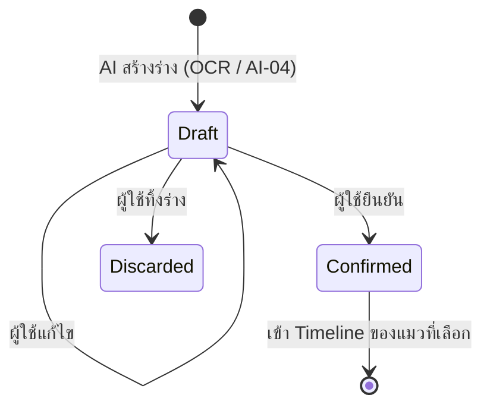
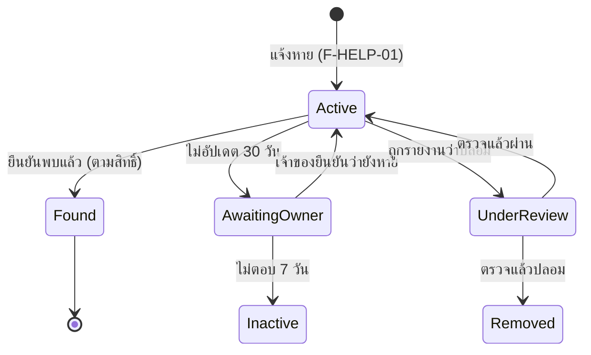
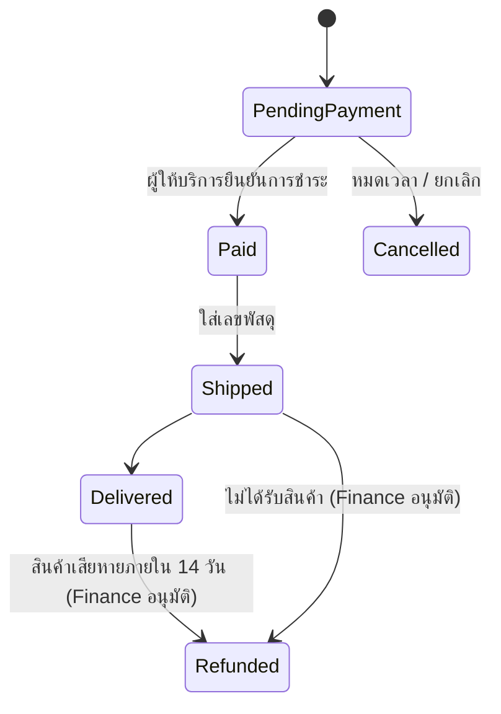
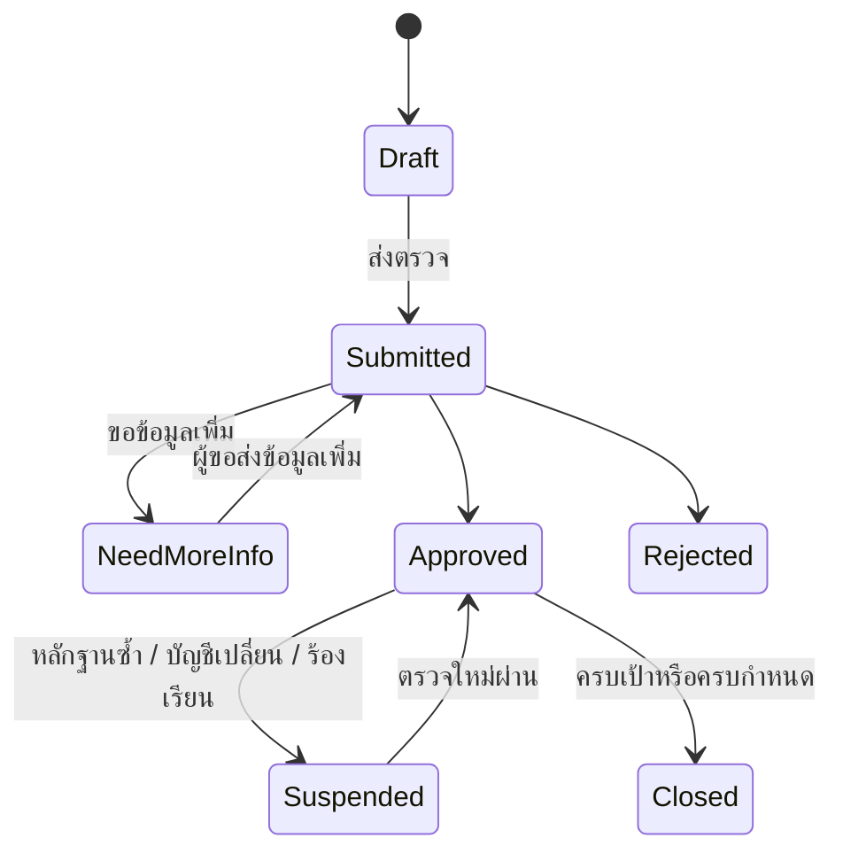

# Feature Specification & RTM Matrix — แมว.live

> ที่มา: แมว.live · เอกสารเก็บความต้องการระบบ v0.6 (16 พ.ย. 2569) — รหัสฟีเจอร์คงตามเอกสารต้นทาง
> ตาราง Master Feature Matrix ครอบคลุมเฉพาะ **Phase 1 · MVP** ที่เป็นขอบเขตส่งมอบปัจจุบัน ฟีเจอร์ Phase 2–3 อยู่ในหัวข้อ 5 (ยังไม่นับเป็นขอบเขตส่งมอบ)
> รายการที่กำกับ `[รอสรุป]` ใช้ค่าเสนอ ยังต้องให้ผู้ตัดสินใจยืนยัน

## 1. ตารางรายการฟีเจอร์หลักและเกณฑ์การตรวจรับมาตรฐาน (Master Feature Matrix & Standard Acceptance)

### 1.1 บัญชีผู้ใช้ สิทธิ์ และการดูแลแมว
| รหัสฟีเจอร์ | ชื่อฟีเจอร์ (Feature Name) | ขอบเขตการทำงาน (Description) | เกณฑ์การตรวจรับมาตรฐาน (Standard Acceptance Checklist) | ความสำคัญ |
| :---: | :--- | :--- | :--- | :---: |
| **NAV-01** | เมนูหลักและเมนู Hamburger | แถบเมนูล่าง 6 รายการ Home / Feed / My Cat / Cat AI / Nearby / Help เมนู Hamburger มีโปรไฟล์ ตั้งค่า ข้อความ ร้านค้า ติดต่อทีม (และปุ่มทางลัดบนหน้าแรก) | 1. เปิดทุกเมนูได้ใน 1 แตะ 2. แถบเมนูล่างแสดงครบ 6 แท็บตามต้นแบบจริง 3. เมนู Hamburger แสดงครบ 5 รายการ | สูง |
| **AUTH-01** | ใช้งานแบบผู้เยี่ยมชม | เปิดแอปครั้งแรกใช้งานเบื้องต้นได้โดยไม่สมัคร | 1. เข้าหน้าที่เปิดให้ผู้เยี่ยมชมได้โดยไม่กรอกข้อมูล | สูง |
| **AUTH-02** | ขอสร้างบัญชีตามบริบท | ขอสร้างบัญชีเมื่อใช้ฟีเจอร์ที่ต้องบันทึก แล้วกลับไปทำรายการเดิม | 1. กดเพิ่มแมวหรือรับคำเชิญแล้วเข้าขั้นตอนสมัคร 2. สมัครสำเร็จแล้วกลับมาที่ขั้นตอนเดิม | สูง |
| **AUTH-03** | เข้าสู่ระบบหลายช่องทาง | เบอร์โทร + OTP, Sign in with Apple, Google และ LINE `[รอสรุป]` บน iOS ต้องมี Apple | 1. ทดสอบผ่านทั้ง 4 วิธี 2. OTP หมดอายุ 5 นาที ขอใหม่ได้หลัง 60 วินาที 3. กรอก OTP ผิด 5 ครั้งล็อก 15 นาที | สูง |
| **AUTH-04** | เชื่อมบัญชีและจัดการอุปกรณ์ | เชื่อมหลายวิธีเข้าระบบกับบัญชีเดียว ออกจากระบบ ดูอุปกรณ์ที่ล็อกอินอยู่ | 1. เข้าด้วยวิธีที่เชื่อมไว้แล้วเห็นแมวชุดเดียวกัน 2. รายการอุปกรณ์แสดงถูกต้อง | สูง |
| **AUTH-05** | ลบบัญชี | ลบบัญชีในแอป Owner ที่มีผู้ดูแลร่วมต้องโอนสิทธิ์หรือยืนยันลบแมวก่อน เก็บ 30 วันก่อนลบจริง | 1. ลบแล้วเข้าใหม่ภายใน 30 วันกู้คืนได้ 2. หลัง 30 วันไม่พบข้อมูล 3. Owner ที่มีผู้ดูแลร่วมถูกบังคับโอนหรือยืนยันก่อน | สูง |
| **F-CAT-01** | จัดการแมวหลายตัวและ Dashboard | เพิ่ม แก้ไข ลบ และสลับแมวได้หลายตัว หน้า My Cat เป็น Dashboard ของแมวที่เลือก | 1. เพิ่ม แก้ไข ลบแมวได้ 2. สลับแมวแล้ว Dashboard และประวัติเปลี่ยนตาม | สูง |
| **F-CAT-02 / 06** | Cat ID, QR และหน้าเว็บสาธารณะ | Cat ID รูปแบบ MAW + 6 หลัก พร้อม QR และหน้าเว็บสาธารณะ เจ้าของเลือกข้อมูลที่เปิดเผยทีละช่อง | 1. ผู้ไม่มีบัญชีเปิด QR ได้ 2. หน้าเว็บแสดงเฉพาะช่องที่เจ้าของเปิด | สูง |
| **F-CAT-08** | พิมพ์แผ่นป้ายและแชร์ Cat ID | สร้างแผ่นป้าย Cat ID เป็น PDF และแชร์ลิงก์ | 1. PDF มี QR ที่สแกนแล้วเปิดหน้าแมวถูกตัว 2. แชร์ลิงก์ได้ | ปานกลาง |
| **F-CAT-09** | แจ้ง "ฉันพบแมวตัวนี้" | คนที่สแกน QR ส่งตำแหน่ง (แบบยินยอม) และข้อความถึง Owner และ Caregiver โดยไม่ต้องมีบัญชี | 1. เจ้าของได้แจ้งเตือนภายใน 1 นาที 2. เบอร์ผู้พบไม่ถูกเปิดเผยถ้าไม่ยินยอม | สูง |
| **F-CAT-03** | ผู้ดูแลร่วม | เชิญผ่านลิงก์หรือเบอร์ บทบาท Owner / Caregiver / Viewer คำเชิญหมดอายุ 7 วัน `[รอสรุป]` โอน Owner ได้ | 1. ทดสอบสิทธิ์ตามตารางสิทธิ์ทุกบทบาท 2. หลังยกเลิกสิทธิ์เข้าถึงไม่ได้ 3. คำเชิญเกิน 7 วันใช้ไม่ได้ | สูง |
| **F-CAT-04 / 05** | Daily Care และการเตือน | บันทึกอาหาร น้ำ ทราย ยา น้ำหนัก พร้อมผู้บันทึกและเวลา ตั้งเตือนอาหาร ยา วัคซีน ถ่ายพยาธิ บันทึกได้ตอนออฟไลน์ | 1. แสดงผู้บันทึกและเวลาถูกต้อง 2. เตือนตรงเวลา ±1 นาที 3. บันทึกตอนออฟไลน์แล้วซิงก์เมื่อออนไลน์ | สูง |
| **SET-01** | ตั้งค่าและช่วยเหลือ | โปรไฟล์ ความเป็นส่วนตัว ภาษา ขนาดตัวอักษร แจ้งเตือน และติดต่อทีม จากเมนู Hamburger | 1. เปิดตั้งค่าและช่องทางช่วยเหลือได้ 2. เปลี่ยนภาษาและขนาดตัวอักษรแล้วมีผลทันที | ปานกลาง |

### 1.2 สุขภาพและ Cat AI
| รหัสฟีเจอร์ | ชื่อฟีเจอร์ (Feature Name) | ขอบเขตการทำงาน (Description) | เกณฑ์การตรวจรับมาตรฐาน (Standard Acceptance Checklist) | ความสำคัญ |
| :---: | :--- | :--- | :--- | :---: |
| **F-HLT-01 / 02** | Timeline สุขภาพ | Timeline และกราฟน้ำหนัก บันทึกวัคซีน ถ่ายพยาธิ ผลตรวจ อาการ ตรวจประจำปี ผ่าตัด | 1. เรียงตามวันที่และแมวที่เลือก 2. กราฟใช้ค่าของแมวตัวเดียวกัน | สูง |
| **F-HLT-03 / AI-06** | อัปโหลดเอกสารและ OCR | อัปโหลดรูปหรือ PDF ใช้ OCR ดึงข้อมูลเป็นร่างให้ตรวจ แก้ และยืนยัน `[รอสรุป DEC-01]` | 1. อ่านค่าได้และแก้ได้ 2. ก่อนยืนยันไม่เข้า Timeline 3. บันทึกเข้าแมวถูกตัว | สูง |
| **F-HLT-04 / AI-07** | Vet Summary | สรุปหนึ่งหน้าเป็น PDF หรือลิงก์ชั่วคราว หมดอายุ 72 ชั่วโมง `[รอสรุป]` | 1. ลิงก์หมดอายุแล้วเปิดไม่ได้ 2. เจ้าของยกเลิกลิงก์ก่อนกำหนดได้ | สูง |
| **AI-01 – 03** | ถาม Cat AI 3 ช่องทาง | ถามด้วยข้อความ เสียงภาษาไทย หรือรูป ใช้บริบทแมวที่ผู้ใช้มีสิทธิ์ | 1. ทดสอบผ่านทั้ง 3 ช่องทาง 2. ไม่ดึงประวัติแมวที่ไม่มีสิทธิ์ 3. เริ่มสตรีมคำตอบภายใน 3 วินาที (p90) | สูง |
| **AI-04** | สรุปแชทเป็นบันทึกอาการ | สรุปแชทเป็นร่างบันทึกอาการ วันที่ ความถี่ ให้ตรวจและยืนยัน | 1. ก่อนยืนยันไม่มีรายการใหม่ใน Timeline 2. หลังยืนยันเห็นรายการในแมวที่เลือก | สูง |
| **AI-05** | ระดับความเร่งด่วน | 3 ระดับ (ดูแลเองได้ / พบสัตวแพทย์เร็ว ๆ นี้ / ฉุกเฉิน) พร้อมทางไปคลินิก 24 ชม. | 1. ทดสอบกับชุดกรณีที่สัตวแพทย์ตรวจแล้ว 2. เคสฉุกเฉินเห็นปุ่มคลินิกทุกครั้ง | สูง |
| **AI-11 / AI-13** | เตือนอัตโนมัติและตรวจเนื้อหา | เสนอการเตือนจากประวัติวัคซีนหรือยา ตรวจโพสต์ รูป คอมเมนต์ และ DM ที่ถูกรายงานตามกติกาชุมชน | 1. ระบบเสนอการเตือนจากประวัติได้ 2. รายการที่ตรวจพบเข้าคิวหลังบ้าน (OPS-02) | ปานกลาง |
| **AI-POL** | กติกาการตอบและการใช้ข้อมูล AI | ข้อความกำกับให้ปรึกษาสัตวแพทย์ งดระบุขนาดยา ให้คะแนนคำตอบ ไม่ฝึกโมเดลหากไม่ยินยอม โควตาต่อบัญชี `[รอสรุป]` | 1. คำตอบสุขภาพทุกคำตอบมีข้อความกำกับ 2. ผู้ใช้ให้คะแนนดี/ไม่ดีได้ 3. เกินโควตาแล้วแจ้งผู้ใช้ | สูง |

### 1.3 ฟีด ข้อความ สถานที่ และการช่วยเหลือ
| รหัสฟีเจอร์ | ชื่อฟีเจอร์ (Feature Name) | ขอบเขตการทำงาน (Description) | เกณฑ์การตรวจรับมาตรฐาน (Standard Acceptance Checklist) | ความสำคัญ |
| :---: | :--- | :--- | :--- | :---: |
| **F-FEED-01 / 02** | โพสต์และแท็บฟีด | โพสต์รูป วิดีโอ หรือข้อความ แท็กแมวของตนเอง แท็บ ทั้งหมด / ติดตาม / บันทึกไว้ กรองตามหมวด `[รอสรุป DEC-03]` | 1. โพสต์แสดงข้อมูลและแท็กถูกต้อง 2. ตัวกรองหมวดทำงาน | สูง |
| **F-FEED-07** | สร้างโพสต์ 2 ขั้น | เต็มจอ: รูปสูงสุด 3 รูป (1:1) หรือวิดีโอ 1 คลิป ≤ 60 วินาที ≤ 200 MB แล้วเขียนคำบรรยาย | 1. เกินข้อจำกัดแสดงข้อความบอกสาเหตุ 2. ไฟล์ที่เกินไม่ถูกอัปโหลด | สูง |
| **F-FEED-08** | แชร์โพสต์และ deep link | แชร์ผ่าน share sheet ของระบบ และคัดลอกลิงก์โพสต์ | 1. ลิงก์เปิดโพสต์ในแอป 2. ไม่มีแอปเปิดหน้าเว็บแทน | ปานกลาง |
| **F-FEED-03 / 04** | ปฏิสัมพันธ์บนโพสต์ | ไลก์ คอมเมนต์ บุ๊กมาร์ก แชร์ โพสต์คำถามติดหมวด | 1. ทดสอบตามระดับบัญชี ผู้ไม่มีสิทธิ์ถูกชวนสมัครหรือยืนยัน | สูง |
| **F-FEED-06** | เมนูจัดการโพสต์ | ไม่สนใจ, ซ่อนโพสต์จากบัญชีนี้, คัดลอกลิงก์, รายงาน (เลือกเหตุผล), บล็อก, ลบโพสต์ตัวเอง | 1. รายงานเข้าคิว OPS-02 2. บล็อกแล้วไม่เห็นโพสต์ คอมเมนต์ และ DM ของกัน | สูง |
| **F-FEED-09** | กติกาชุมชน | ห้ามโฆษณาหรือขายอาหารแมว ยกเว้นบัญชีพาร์ตเนอร์ที่มีป้ายกำกับ | 1. ผู้ใช้เห็นกติกาก่อนโพสต์ครั้งแรก 2. โพสต์พาร์ตเนอร์มีป้าย | ปานกลาง |
| **F-FEED-10** | แถบประกาศแมวหายในโพสต์ | โพสต์จากประกาศแมวหายมีแถบ "ประกาศแมวหาย · แจ้งเบาะแส" | 1. แตะแถบเปิดประกาศต้นทาง 2. ปิดประกาศแล้วแถบเปลี่ยนเป็น "พบแล้ว" | ปานกลาง |
| **MSG-01** | ข้อความส่วนตัว 1:1 | DM ระหว่างบัญชีที่ยืนยันแล้ว ส่งข้อความและรูป เริ่มจากโปรไฟล์ โพสต์ หรือประกาศ | 1. ข้อความถึงผู้รับภายใน 3 วินาทีเมื่อออนไลน์ 2. มีสถานะอ่านแล้ว | สูง |
| **MSG-02** | คำขอข้อความ | คนที่ไม่ได้ติดตามกันส่งได้ 1 ข้อความจนกว่าผู้รับตอบรับ `[รอสรุป]` | 1. ผู้รับเลือกรับ ลบ หรือบล็อกได้ 2. ส่งข้อความที่ 2 ไม่ได้จนกว่าจะตอบรับ | ปานกลาง |
| **MSG-03** | เครื่องมือห้องแชท | ปิดเสียง รายงาน บล็อก ลบบทสนทนา | 1. รายงานแนบข้อความล่าสุด 20 ข้อความให้ผู้ตรวจ | ปานกลาง |
| **MSG-04** | เตือนก่อนส่งข้อมูลเสี่ยง | เตือนก่อนส่งเบอร์โทร เลขบัญชี หรือลิงก์ชำระเงิน กันมิจฉาชีพในเคสแมวหาย | 1. แสดงคำเตือนก่อนส่งทุกครั้งที่ตรวจพบ | ปานกลาง |
| **F-NB-01 – 03** | Nearby คลินิกและฉุกเฉิน | แผนที่เต็มจอและรายการคลินิก / ฉุกเฉิน เวลาเปิด โทร นำทาง เริ่มจากตำแหน่งจริง (ขอสิทธิ์ก่อน) | 1. กดโทรหรือนำทางได้ 2. สถานะเปิดอยู่ใช้เวลาที่ตรวจสอบแล้ว 3. ปฏิเสธสิทธิ์ตำแหน่งแล้วค้นด้วยเขตได้ | สูง |
| **F-HELP-01 / AI-14** | แจ้งแมวหายและโปสเตอร์ | แจ้งหายจากโปรไฟล์ ระบุวัน เวลา ตำแหน่ง สร้างโปสเตอร์พร้อม QR เผยแพร่ใน Help และ Feed | 1. ใช้แมวถูกตัว 2. พิกัดแสดงแบบประมาณรัศมี 500 ม. `[รอสรุป DEC-04]` 3. โปสเตอร์มี QR ที่ใช้งานได้ | สูง |
| **F-HELP-05** | แจ้งเตือนแมวหายใกล้ตัว | แจ้งเตือนผู้ใช้ในรัศมี 3 กม. เมื่อมีประกาศหาย `[รอสรุป]` ผู้ใช้ปิดรับได้ | 1. ผู้ใช้ในรัศมีได้แจ้งเตือนภายใน 5 นาที 2. ไม่เกิน 3 ครั้งต่อวัน | สูง |
| **F-HELP-06** | อายุประกาศและประกาศปลอม | ไม่อัปเดต 30 วันระบบถามเจ้าของ ไม่ตอบ 7 วันย้ายเป็นไม่ใช้งาน ประกาศที่ถูกรายงานเข้าคิวตรวจ | 1. สถานะเปลี่ยนตามกำหนดเวลา 2. ประกาศที่ถูกรายงานเข้าคิว OPS-02 | ปานกลาง |
| **F-HELP-02** | แจ้งพบแมว | แจ้งพบพร้อมรูปและตำแหน่ง ยืนยันพบแล้วเพื่อปิดประกาศตามสิทธิ์ | 1. ลงประกาศพบได้ 2. ปิดประกาศได้เฉพาะผู้มีสิทธิ์ | สูง |
| **F-HELP-04** | หน้าฉุกเฉิน | อาการที่ต้องไปทันที รพ.สัตว์ 24 ชม. ที่ใกล้ที่สุด ปุ่มโทรด่วน ใช้ได้แม้ไม่ล็อกอิน | 1. เปิดจากหน้า Help ได้ใน 1 แตะ 2. ใช้ได้โดยไม่ล็อกอินและตอนออฟไลน์ 3. เบอร์ผ่านการตรวจทุก 90 วัน | สูง |

### 1.4 ร้านค้า Tag และการบริจาค (MVP)
| รหัสฟีเจอร์ | ชื่อฟีเจอร์ (Feature Name) | ขอบเขตการทำงาน (Description) | เกณฑ์การตรวจรับมาตรฐาน (Standard Acceptance Checklist) | ความสำคัญ |
| :---: | :--- | :--- | :--- | :---: |
| **TAG-01** | หน้าสินค้า Tag | หน้าสินค้า Tag และปลอกคอ พร้อมรูป 3D หมุนดูได้ ราคา สี และรายละเอียด | 1. ราคาตรงกับหลังบ้าน (OPS-03) 2. หมุนดูรูป 3D ได้ | ปานกลาง |
| **TAG-02** | ช่องทางสั่งซื้อ Tag | iOS: ปุ่ม "สั่งซื้อบนเว็บ" เปิดเบราว์เซอร์ภายนอก / Android และเว็บ: จ่ายผ่าน QR PromptPay หรือบัตร `[รอสรุป]` | 1. iOS ไม่มีหน้าจ่ายเงินในแอป 2. Android และเว็บชำระสำเร็จทั้ง 2 วิธี | ปานกลาง |
| **TAG-03** | ผูก Tag กับแมว | สแกน QR บน Tag หนึ่ง Tag ต่อแมวหนึ่งตัว ย้ายได้เมื่อ Tag หาย | 1. สแกน Tag แล้วเปิด Cat ID ของแมวที่ผูก 2. ผูก Tag เดียวกับแมว 2 ตัวไม่ได้ | ปานกลาง |
| **TAG-04** | สถานะออเดอร์ | รอชำระ → ชำระแล้ว → จัดส่ง (เลขพัสดุ) → ส่งถึง / ยกเลิก | 1. ผู้ซื้อได้แจ้งเตือนทุกสถานะ 2. แสดงเลขพัสดุเมื่อจัดส่ง | ปานกลาง |
| **TAG-05** | คืนเงินและใบเสร็จ | คืนเงินเมื่อสินค้าเสียหายหรือไม่ได้รับภายใน 14 วัน `[รอสรุป]` ออกใบเสร็จอิเล็กทรอนิกส์ | 1. หลังบ้านอนุมัติคืนเงินและบันทึกผู้อนุมัติ 2. ผู้ซื้อได้ใบเสร็จ | ปานกลาง |
| **DON-00** | แสดงเคสระดมทุน | แสดงเคสใน Help โดยไม่มีปุ่มรับเงินใน MVP | 1. เห็นเฉพาะเคสที่ผ่าน DON-04 2. ไม่มีปุ่มบริจาคและข้อมูลบัญชี | ปานกลาง |
| **DON-04** | อนุมัติและเผยแพร่เคส | ร่าง → ส่งตรวจ → ขอข้อมูลเพิ่ม / อนุมัติ / ปฏิเสธ หน้าเคสแสดงวัตถุประสงค์ เป้าหมาย ระยะเวลา สถานะ | 1. สถานะเปลี่ยนตามลำดับที่กำหนด 2. หลักฐานที่แสดงปกปิดข้อมูลส่วนตัวแล้ว | ปานกลาง |
| **DON-06** | ร้องเรียนและระงับเคส | ช่องรายงานเคส พักหน้าเคสเมื่อพบหลักฐานซ้ำ บัญชีเปลี่ยน หรือมีข้อร้องเรียน | 1. เก็บเหตุผลและผู้ตรวจทุกครั้ง 2. เคสที่ถูกพักไม่แสดงต่อผู้ใช้ | ปานกลาง |

### 1.5 การแจ้งเตือน หลังบ้าน PDPA และ Store
| รหัสฟีเจอร์ | ชื่อฟีเจอร์ (Feature Name) | ขอบเขตการทำงาน (Description) | เกณฑ์การตรวจรับมาตรฐาน (Standard Acceptance Checklist) | ความสำคัญ |
| :---: | :--- | :--- | :--- | :---: |
| **NOTI-01** | ประเภทการแจ้งเตือน | เตือนการดูแล, มีคนพบแมว, แมวหายใกล้ตัว, คำเชิญผู้ดูแล, DM, ปฏิสัมพันธ์บนโพสต์, ออเดอร์, ประกาศจากทีม | 1. เปิดปิดแยกตามประเภทได้ 2. "มีคนพบแมว" ปิดไม่ได้ | สูง |
| **NOTI-02** | ช่วงห้ามรบกวน | 22:00–07:00 ตั้งค่าได้ ยกเว้นเตือนยาและมีคนพบแมว | 1. ไม่มีแจ้งเตือนอื่นในช่วงที่ตั้ง 2. เตือนยาและพบแมวยังส่งถึง | ปานกลาง |
| **NOTI-03** | กล่องแจ้งเตือนและ deep link | กล่องแจ้งเตือนในแอป แตะแล้วเปิดหน้าที่เกี่ยวข้อง | 1. แตะ push แล้วไปหน้าถูกต้องทั้งตอนแอปปิดและเปิดอยู่ | สูง |
| **OPS-01** | ระบบหลังบ้านและบทบาท | เว็บหลังบ้าน บทบาท Admin / Moderator / Ops / Finance บันทึก audit log ทุกการกระทำ | 1. แต่ละบทบาทเห็นเฉพาะเมนูของตน 2. เข้าสู่ระบบด้วย 2FA 3. ทุกการกระทำมี audit log | สูง |
| **OPS-02** | คิวตรวจเนื้อหา | รายงานโพสต์ คอมเมนต์ DM ประกาศ และที่ AI-13 ตรวจพบ ซ่อน / ลบ / เตือน / ระงับบัญชี | 1. รายงานได้รับการตรวจภายใน 24 ชั่วโมง `[รอสรุป]` 2. ผู้รายงานได้แจ้งผล | สูง |
| **OPS-03** | จัดการสินค้า ออเดอร์ และข้อมูลอ้างอิง | สินค้า ราคา สต็อก ออเดอร์ เลขพัสดุ คืนเงิน ตรวจเคสบริจาค ข้อมูลคลินิกและเบอร์ฉุกเฉิน | 1. แก้ในหลังบ้านแล้วแอปเห็นภายใน 5 นาที | สูง |
| **OPS-04** | Feature flag และบังคับอัปเดต | flag แยกตามแพลตฟอร์มและเวอร์ชันแอป เปิดปิดได้โดยไม่ต้องอัปเดตแอป บังคับอัปเดตเมื่อเวอร์ชันต่ำกว่ากำหนด | 1. ปิด flag แล้วฟีเจอร์หายภายในการเปิดแอปครั้งถัดไป 2. เวอร์ชันต่ำกว่ากำหนดถูกบังคับอัปเดต | สูง |
| **PDPA-01** | ความยินยอม | นโยบายความเป็นส่วนตัว ข้อกำหนดการใช้งาน ขอความยินยอมแยกเรื่อง: ตำแหน่ง การตลาด ใช้ข้อมูลฝึก AI | 1. ถอนความยินยอมได้จาก Settings 2. เก็บประวัติความยินยอมพร้อมเวอร์ชัน | สูง |
| **PDPA-02** | ขอสำเนาและลบข้อมูล | ขอสำเนาข้อมูลของตนเอง (JSON + PDF) และลบข้อมูลตาม AUTH-05 | 1. ได้ไฟล์ภายใน 30 วัน | สูง |
| **PDPA-03** | ข้อจำกัดอายุ | ต่ำกว่า 13 ปีสมัครไม่ได้ 13–19 ปีต้องได้ความยินยอมผู้ปกครองก่อนชำระเงิน `[รอสรุป Legal]` | 1. ถามปีเกิดตอนสมัคร 2. อายุต่ำกว่า 13 ปีสมัครไม่สำเร็จ | สูง |
| **PDPA-04** | เข้ารหัสข้อมูลอ่อนไหว | เบอร์ ที่อยู่ ตำแหน่ง เอกสารตัวตน เลขบัญชี เข้ารหัสระดับฟิลด์ เห็นเฉพาะบทบาทที่จำเป็น | 1. ทดสอบด้วยบทบาทหลังบ้านทุกบทบาท | สูง |
| **STORE-01** | ตรวจกติกา Store | ตรวจกติกา App Store และ Google Play เรื่องสินค้าจริง ของขวัญ การบริจาค และลิงก์ชำระเงินภายนอก | 1. มีบันทึกผลตรวจและค่า flag ต่อแพลตฟอร์ม | สูง |
| **STORE-02** | เตรียมข้อมูลส่ง Store | บัญชีทดสอบสำหรับผู้ตรวจ, Privacy Nutrition Label, Data Safety form, คำอธิบายสิทธิ์กล้อง ไมค์ ตำแหน่ง | 1. ผ่านการรีวิวครั้งแรกทั้ง 2 Store | สูง |

---

## 2. [มิติที่ 2] ลำดับสถานะและเวิร์กโฟลว์ (State Machine & Workflow Transitions)

### 2.1 ข้อมูลที่ AI สร้าง (OCR / สรุปแชท)

### 2.2 ประกาศแมวหาย

- เปลี่ยนแมวเป็น "จากไปแล้ว" (P2) ปิดประกาศหายอัตโนมัติ

### 2.3 ออเดอร์ Tag

### 2.4 เคสบริจาค

- **กฎการควบคุมสถานะ:** การเปลี่ยนสถานะออเดอร์ คืนเงิน และเคสบริจาคในหลังบ้านบันทึก audit log พร้อมผู้อนุมัติและเหตุผลทุกครั้ง

---

## 3. [มิติที่ 4] การเชื่อมต่อระบบภายนอก (Integration Complexity)
ผู้ให้บริการเฉพาะยังรอสรุปใน DEC-05 / DEC-04
- **ยืนยันตัวตน:** SMS OTP, Sign in with Apple, Google, LINE Login
- **AI:** LLM สำหรับแชท, Vision สำหรับรูปและ OCR, STT ภาษาไทยสำหรับคำถามเสียง (ผู้ให้บริการ `[รอสรุป DEC-05]`)
- **แผนที่และสถานที่:** Google Places + ข้อมูลที่ Ops ตรวจสอบ `[รอสรุป DEC-04]`
- **การชำระเงิน:** QR PromptPay และบัตร ผ่านผู้ให้บริการชำระเงิน ส่งสำเร็จเมื่อผู้ให้บริการยืนยัน กันชำระซ้ำด้วย idempotency key
- **Push notification:** APNs / FCM พร้อม deep link
- **Store:** Apple App Store และ Google Play (กติกาตาม STORE-01)

---

## 4. [มิติที่ 9] ความซับซ้อนของหน้าจอและประสบการณ์ผู้ใช้ (UI / Frontend Intricacy)
- **Native mobile flows:** แอป iOS และ Android, deep link จาก push และลิงก์โพสต์, share sheet ของระบบ
- **Cat AI:** แชทแบบสตรีม รองรับข้อความ เสียงภาษาไทย และรูป
- **แผนที่เต็มจอ:** Nearby และพิกัดประกาศแบบประมาณ
- **รูป 3D หมุนดูได้:** หน้าสินค้า Tag
- **ออฟไลน์:** แคชโปรไฟล์แมว Health Record และหน้าฉุกเฉิน บันทึก Daily Care แบบออฟไลน์แล้วซิงก์
- **Accessibility:** ไทย/อังกฤษ, Dynamic Type ถึง 200%, WCAG AA
- **หน้าเว็บ Cat ID สาธารณะ:** เปิดจาก QR บนเบราว์เซอร์โดยไม่ต้องมีแอป

---

## 5. ฟีเจอร์นอกขอบเขต MVP (ยังไม่นับเป็นขอบเขตส่งมอบ)
- **Phase 2:** F-CAT-07 Memories `[รอสรุประยะ]`, F-CAT-10 สถานะจากไปแล้วและ Memorial, SET-02 ที่อยู่จัดส่งส่วนตัว, AI-08 Health Insights, AI-09 เดาพันธุ์, AI-10 จับคู่แมวหาย, AI-12 Feed Assistant, AI-15 โทรคุยกับสัตวแพทย์ AI, AI-16 ตรวจใบหน้าแมว, F-NB-04 หมวด Nearby อื่น, F-HELP-03 รับเลี้ยง / อุปการะ, TRK-01 Tracker ตำแหน่งแมว, F-FEED-05 Clubs / Events, GIFT-01 ถึง 06 ระบบส่งขนม, DON-01 / 02 / 03 / 05 เปิดรับเงินบริจาค
- **Phase 3:** Pedigree, ประกัน, Vet Portal แบบให้สิทธิ์, Marketplace, สั่ง Tag ในแอป iOS

