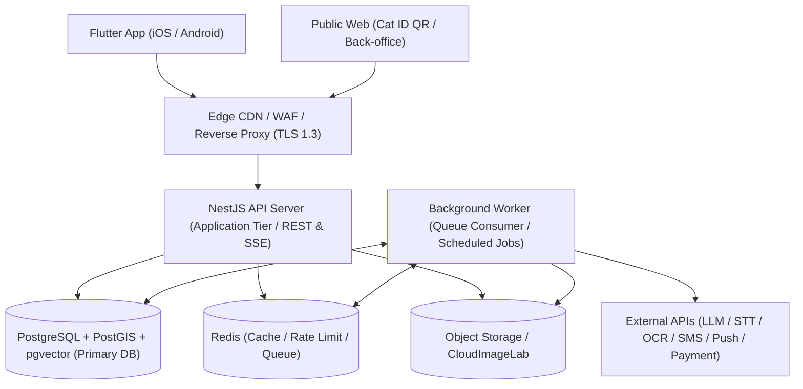

# System Architecture — แมว.live

> **เอกสารอ้างอิง:** `docs/backend-architecture.md`, `docs/data-schema.md`, สเปก v0.6 และโครงสร้างแอป Flutter (`app/lib/features/`)

---

## 1. [มิติที่ 1] โครงสร้างสถาปัตยกรรมระบบและแผนภาพ Topology (Architecture Complexity)
> ระบบ `แมว.live` ออกแบบเป็น Modular Monolith ฝั่ง Backend (NestJS) เพื่อรองรับการขยายเป็น Microservices ในอนาคต เชื่อมต่อกับแอปมือถือ Flutter (iOS / Android) และหน้าเว็บสาธารณะ (Cat ID QR)

- **โครงสร้าง Frontend Client (`app/`):**
  - **Framework:** Flutter (Dart SDK `^3.13.7`), State Management ด้วย `flutter_riverpod`, Routing ด้วย `go_router`, HTTP Client ด้วย `dio`, แผนที่ด้วย `flutter_map` + `geolocator`
  - **สถาปัตยกรรม Feature-First Clean Architecture:** แยกเป็น 13 โมดูลอิสระ (`shell`, `home`, `feed`, `my_cat`, `nearby`, `help`, `cat_ai`, `menu`, `messages`, `search`, `treats`, `notifications`, `tag`) แต่ละโมดูลแบ่งชั้น `domain/`, `data/`, และ `presentation/`
- **โครงสร้าง Backend Modules (`NestJS`):**
  - แบ่งตาม Domain: `AuthModule`, `UsersModule`, `CatsModule`, `FeedModule`, `ReportsModule`, `AnnouncementsModule`, `SightingsModule`, `PlacesModule`, `AiModule`, `PaymentsModule`, `DevicesModule`, `ChatModule`, `NotificationsModule`, `FilesModule`, `AuditModule`, `EventsModule`, `WebhooksModule`

---

## 2. [มิติที่ 3] สถาปัตยกรรมข้อมูล ความลึก ERD และการรองรับข้อมูลขนาดใหญ่ (Data & ERD Complexity)
- **เทคโนโลยีฐานข้อมูล:** PostgreSQL + **PostGIS** (คำนวณระยะทางและรัศมี 500 ม. / 3 กม.) + **pgvector** (จัดเก็บ Knowledge Embeddings สำหรับ Cat AI)
- **หลักการแยกตารางข้อมูลลับ (Table-Level Privacy Isolation):**
  - แยกข้อมูลอ่อนไหวออกจากตารางสาธารณะอย่างเด็ดขาด เช่น `user_private` (เบอร์โทร, ที่อยู่จัดส่ง, เลขบัญชี), `cat_caretakers` (สิทธิ์ Owner/Caregiver/Viewer) และ `announcements` (แยก `location_point` จริงออกจาก `area_label` สาธารณะ) เพื่อป้องกันข้อมูลหลุดผ่าน API สาธารณะ
  - ใช้ `uuid` เป็น Primary Key, `timestamptz` สำหรับเวลา, `jsonb` สำหรับข้อมูลเมตาที่ยืดหยุ่น และ Soft Delete (`deleted_at`) เพื่อรองรับ PDPA (`AUTH-05`, `PDPA-02`)
- **การออกแบบคิวรีรองรับข้อมูลปริมาณสูง (High-Scale Ready):**
  - ป้องกัน N+1 Queries ด้วยการดึงข้อมูลแบบ Batch (`WHERE id = ANY($1)`) และ Bulk Upsert
  - ใช้ **Spatial Index (`GIST`)** บนคอลัมน์พิกัด PostGIS (`places.location`, `announcements.location_point`) และ **Composite / Partial Indexes** (เช่น `(cat_id, recorded_at DESC)` สำหรับ Health Timeline และ `WHERE deleted_at IS NULL` สำหรับโพสต์/ประกาศที่ยังใช้งาน)

---

## 3. [มิติที่ 5] การประมวลผลเบื้องหลัง คิวงาน และการควบคุม Concurrency (Async & Concurrency)
- **สถาปัตยกรรมคิวงานและ Worker:**
  - **คิวด่วนแบบเรียลไทม์ (Real-time Queue):** แจ้งเตือนคนพบแมวจากการสแกน QR (`F-CAT-09` ภายใน 1 นาที), แจ้งเตือนแมวหายในรัศมี 3 กม. (`F-HELP-05` ภายใน 5 นาที และจำกัด <= 3 ครั้ง/วัน), และส่งข้อความแชท DM (`MSG-01` ภายใน 3 วินาที)
  - **คิวประมวลผลรอบระยะเวลา (Scheduled Jobs):** ตรวจสอบประกาศแมวหายที่ไม่เคลื่อนไหว 30 วัน + 7 วัน (`F-HELP-06`), ตรวจสอบความถูกต้องเบอร์ รพ.สัตว์ทุก 90 วัน (`F-HELP-04`), ล้างข้อมูลบัญชีที่ขอลบครบ 30 วัน (`AUTH-05`), และหมดอายุลิงก์ Vet Summary 72 ชม.
- **การควบคุม Concurrency และ Idempotency:**
  - ใช้ Database Transaction + Row-Level Locking (`SELECT ... FOR UPDATE`) และ **Idempotency Key** สำหรับ Webhook ชำระเงินค่าขนม/Tag เพื่อป้องกันการตัดเงินซ้ำหรืออัปเดตสถานะออเดอร์ซ้อนทับ
  - ระบบซิงก์ข้อมูล Offline-first (`NFR-07`) สำหรับ Daily Care ใช้ Timestamp ล่าสุดในการ Resolve Conflict (Last-Write-Wins)

---

## 4. [มิติที่ 6 & 7] ความมั่นคงปลอดภัย การแคชหลายระดับ และระบบสำรองอัตโนมัติ (Security, Scalability & SLA)
- **การออกแบบระบบแคชหลายระดับ (Multi-Tier Caching):**
  - **Client Cache:** แคชโปรไฟล์แมว, Health Record ล่าสุด และหน้าฉุกเฉินลง Local Storage เพื่อให้อ่านได้ตอนออฟไลน์ (`NFR-07`)
  - **Edge CDN:** แคชไฟล์รูปภาพ/วิดีโอสาธารณะและหน้าเว็บ Cat ID สาธารณะ
  - **Redis Server Cache:** แคช Feature Flags (`OPS-04` อัปเดตภายใน 5 นาที), สถานะเปิด-ปิดคลินิก, รายการสินค้า Tag และข้อมูล Feed ยอดนิยม พร้อมกำหนด TTL
- **การป้องกันเชิงลึก (Defense-in-Depth Security):**
  - เข้ารหัส TLS 1.2+ ระหว่างส่ง และ AES-256 ระดับฟิลด์สำหรับข้อมูลอ่อนไหว (`PDPA-04`)
  - ลบข้อมูลพิกัด GPS/EXIF ออกจากไฟล์รูปภาพทุกครั้งก่อนจัดเก็บ (`stripImageMetadata` ฝั่ง Client + Re-encode ฝั่ง Server/CloudImageLab)
  - บังคับ Rate Limiting ที่ Edge/API (เช่น OTP ขอใหม่หลัง 60 วินาที, ผิด 5 ครั้งล็อก 15 นาที, โควตา Cat AI 50 ข้อความ/วัน) และบันทึก `audit_logs` ทุกการกระทำสำคัญ (`OPS-01`)

---

## 5. [มิติที่ 8] โครงสร้างพื้นฐานและการปฏิบัติการระบบ (Operational & Infrastructure)
- **การจัดวางคอนเทนเนอร์และโปรเซส (Deployment & Process Topology):**
  - แยกรัน Container ของ **API Server**, **Background Worker**, และ **Back-office Web** อิสระจากกัน เพื่อให้ Scale API รองรับ 5,000 Concurrent Users ได้โดยไม่กระทบคิวงานเบื้องหลัง
  - มี Health Check Endpoints (`/healthz`, `/readyz`), Graceful Shutdown (รอเคลียร์ Request และ Worker Job ที่ค้างก่อนปิดโปรเซส), และการ Deploy แบบ Zero-Downtime
  - มีระบบ Feature Flag แยกตามแพลตฟอร์ม (iOS/Android/Web) และเวอร์ชันแอป เพื่อเปิด/ปิดฟีเจอร์และบังคับอัปเดตได้ทันทีโดยไม่ต้องส่งแอปขึ้น Store ใหม่ (`OPS-04`)
